# Recovering failed uplink blocks before HARQ in AI-RAN servers

논문 A의 작업 디렉터리. Antiphase(논문 B, `airan_cloudlab`)와 분리했다. 이 디렉터리의 코드·결과·큐는 Antiphase 쪽과
섞이지 않는다. 큰 자산(Aerial 이미지와 저장소, TensorRT 엔진, TensorFlow·Sionna 패키지)만 `airan_cloudlab`에서 읽는다
(`env.sh`, `src/vendor/SOURCE.md`).

## 1. 구조의 정의

| 항목 | 정의 |
|---|---|
| AI-RAN 서버 | GPU에서 여러 셀의 L1(cuPHY)과 AI 추론을 함께 실행하는 기지국 서버. 각 상향 슬롯의 수신 신호가 GPU 메모리에 남는다 |
| 세 작업 | L1 기존 수신기(모든 블록, 필수), 복구(CRC가 실패한 블록만, 선택), AI(남는 GPU) |
| 블록의 두 마감 | L1 마감 4.0 ms(모든 블록). 복구 마감: 비동기 상향 HARQ가 허용하는 범위 안에서 고르는 설계값(11.5 ms). 규격은 재전송 grant 시점의 하한(K2, PUSCH 준비 시간)만 정하고 상한은 DRX 타이머뿐이다 (TS 38.300 §5.3.5.4, 38.321 §5.4.2.1, 38.214 §6.1/§6.4) |
| 복구 | CRC가 실패한 블록을 이미 받은 샘플로, 채널 추정부터 다른(더 강한) 수신기로 다시 처리하는 것. 재전송 grant 전에 성공하면 재전송을 요청하지 않는다. 실패하면 표준 HARQ로 간다 |
| 복구와 구별할 것 | HARQ(새로 받음), L1 안의 NRx(모든 블록을 마감 안에), 복호기만 바꾸는 재복호(같은 LLR), 예측 기반 HARQ(Nuberu, Hades) |
| AI-RAN Alliance 분류와의 관계 | AI-for-RAN(NRx), AI-and-RAN(L1과 AI의 GPU 공유), AI-on-RAN(LLM)이 한 GPU에서 만나는 구조 |

## 2. 문제 정의

> In 5G NR uplink, a transport block that fails CRC is handled only by HARQ: each failure costs a scarce uplink slot,
> user transmit energy and a round trip, and failures concentrate where co-scheduled users are hard to separate. Neural
> receivers separate such users better, but the models that help most miss the per-block Layer-1 deadline.
> Asynchronous uplink HARQ gives failed blocks a later deadline, and AI-RAN servers already hold their samples and spare
> GPU time. We ask whether the base station can recover failed blocks before asking for a resend, and what that buys.

서론의 논리와 근거(규격 조항, 운용 측정, 기존 연구의 문장)는 `docs/PLAN.md` 1절, 관련 연구 전체는 `docs/related_work.md`.

## 3. 기여

1. 구조와 두 마감의 정의, 표준(비동기 상향 HARQ) 안의 복구 마감.
2. 복구 경로: CRC가 실패한 블록만 이미 받은 샘플로 Large NRx가 다시 풀고, HARQ와 병렬로 둔다. 어떤 조건에서도 HARQ만 쓰는 것보다 지는 지표가 없다.
3. 실패의 원인과 복구의 값: 실패와 복구는 같은 자원을 쓰는 사용자 신호가 겹치는 쌍(상향 MU-MIMO의 기본 상황)에 몰리고, 대형 기지국(UMa)에서 값이 크다. Large NRx가 고전 강한 수신기를 모두 합친 것보다 많이 살린다.
4. 시스템 수준의 값: 링크 적응 처리량, 짝 고르기의 대체, 지연 꼬리, 끝내 못 받는 블록.
5. 복구 비용과 고르기: GPU 한 장의 실측 처리량, L1 결과만으로 살릴 블록을 고르는 예측기, 작은 NRx → Large NRx 연쇄.
6. 셀 간 간섭에 맞춘 복구 수신기: 간섭으로 학습한 신경 수신기가 공분산 기반 결합(IRC)보다 낫다는 것은 알려져 있다(DeepRx, TWC 2021; EqDeepRx, arXiv 2602.11834). 우리의 기여는 측정과 배치 방식이다: 셀 간 간섭 없이 학습된 공개 NVlabs NRx를 그대로 쓰면 이웃 셀 간섭(잡음 대비 3–10 dB) 아래에서 MMSE-IRC 대비 복구 이득이 거의 사라지고, AI-RAN 서버의 GPU에서 셀의 간섭에 맞춰 미세 조정하면 되살아난다. 신경 수신기를 실패 블록 복구에만 쓰는 연구와, 그 값을 IRC 앞에서 잰 연구는 찾지 못했다(조사: `/pscratch/sd/s/sgkim/kcj/reports/interference_aware_nrx_prior_work.md`).

## 4. 핵심 결과 (2026-10-18; 전체 표와 분석은 [docs/RESULTS.md](docs/RESULTS.md), 데이터 표는 `results/summary/`)

| 주장 | 수치 (괄호: 묶음 재표본 95% 구간) |
|---|---|
| 재전송 감소 | 소형 기지국(UMi) 0.75배 [0.74–0.76], 대형(UMa) 0.42–0.44배 [0.40–0.46], 대형·비가시선 0.26–0.27배 |
| 끝내 못 받는 블록 | UMi 2.21 → 1.48%, UMa 2.15 → 0.84%, UMa 비가시선 1.11 → 0.32% |
| 유지되는 범위 | 3–120 km/h, MCS 12/14/16, 재전송 혼자/같은 짝, 가시선/비가시선, Eb/No 2–16 dB: 지는 조건 없음 |
| 효과가 몰리는 곳 | 짝 상관 ≥ 0.4(블록의 66%)에서 실패의 27–29%, 0.4 미만 14% (UMi) |
| 수신기 비교 (같은 슬롯) | 살린 실패 Large NRx 42.5/54.1%, K-best 37.0/42.9, 작은 NRx 30.4/39.1, IDD 19.4/20.6, LDPC 50회 7.0/9.9 (UMi/UMa); 다른 방법만 살리는 블록 0.6–0.9% |
| 지연 | 병렬 복구: 10 ms 안에 못 받는 블록 4.40 → 3.19%, 복구될 블록 9.4 → 7.7 ms |
| 처리량 | 링크 적응 목표 10%: UMi +14–21%, UMa +22–42%; 목표 3%: UMa 최대 +75% |
| 짝 고르기 | 무작위 짝 + 복구 ≈ 8명 중 고른 짝 + 기존 수신기 (UMi 재전송 12.2 대 12.8, UMa 9.1 대 16.4) |
| 고르기 | 실패 조각 1개 98%, 2–5개 84–93% 복구; 조각 ≤ 5면 기다리고 나머지 병렬: 지연 그대로 재전송 17.5 → 14.5; 예측기(AUC 0.865)로 실패의 50%만 Large NRx에 주면 복구 가치의 83% |
| GPU | Large NRx는 A100 한 장을 다 쓰며 초당 233회(4.3 ms, 동시 실행해도 늘지 않음); 기지국 하나가 초당 92–96회 필요 → 전부 복구하면 A100 한 장에 약 2.4개 |
| 약점 | 짧게 추가 학습한 3–4명·8 RX 모델은 K-best보다 약함(8 RX UMa 제외) → "Large NRx가 필요하다"는 원 모델(2명·4 RX)에서만 주장; 추가 학습 중 |

## 5. 평가

공통 설정: 3GPP 채널(Sionna 0.18, NVlabs 생성기), 273 PRB, 수신 안테나 4개, 사용자 2명이 같은 자원, MCS 14, IR HARQ 최대 4회(7.5 ms 간격), 런타임 수신기는 NVIDIA Aerial cuPHY와 TensorRT(A100). 막대 위 숫자 중 파란 숫자는 우리 값, 검은 "N×"는 그 방식이 우리의 몇 배인지다(재전송·못 받은 블록은 클수록 나쁘다). 모든 그림은 `python3 figures/make_figures.py`로 `results/`에서 다시 그린다.

### 5.1 복구 경로는 모든 채널 조건에서 재전송과 끝내 못 받는 블록을 줄인다

**요지.** 기존 수신기(L1)만 쓰는 지금의 기지국은 소형 기지국에서 우리의 1.3배, 대형 기지국에서 2.2–2.3배, 건물에 가려진 대형 기지국에서 3.8배 재전송을 요청한다.

<p align="center">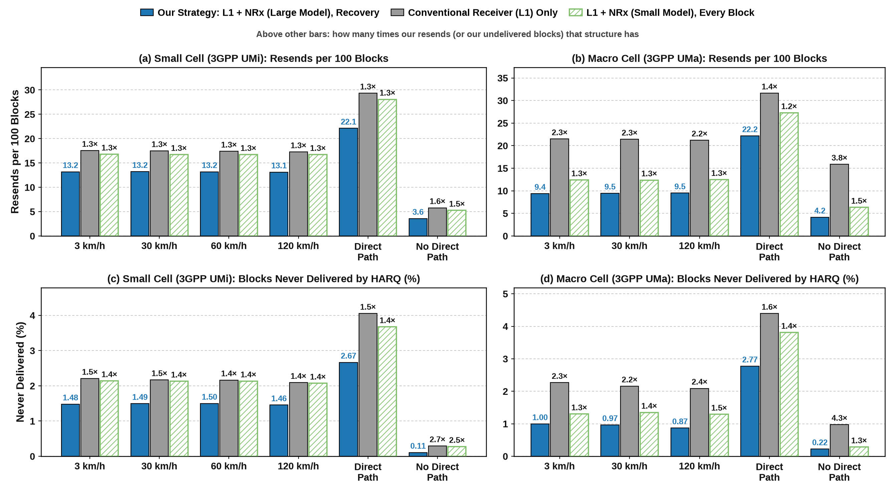</p>
<p align="center"><b>그림 1.</b> 채널·속도·가시선 조건별 100블록당 재전송(위)과 HARQ로 끝내 못 받는 블록(아래)</p>

**그림 설명.** 왼쪽은 도심 골목의 소형 기지국(3GPP UMi), 오른쪽은 건물 옥상의 대형 기지국(3GPP UMa)이다. 묶음마다 막대 셋은 우리(파랑), 기존 수신기만(회색), 작은 NRx를 모든 블록에 쓰는 AI-for-RAN(빗금)이다. 조건은 사용자 속도 3–120 km/h와 직접 경로가 있는/없는(가시선/비가시선) 경우다. 조건당 블록 10,240–20,480개.

**결과와 이유.**
- **속도가 결과를 바꾸지 않는다** (소형 기지국 재전송 13.1–13.2, 1.3배). 273 PRB 전대역이라 빠른 페이딩은 주파수로 평균되고, 블록 성패를 정하는 사용자 이득과 짝 상관은 22 ms 안에 거의 변하지 않는다.
- **대형 기지국에서 효과가 크다** (재전송 21.5 → 9.4, 끝내 못 받는 블록 2.27 → 1.00%). 지연 확산이 커서 cuPHY의 채널 추정이 약하고, UMi로 학습된 Large NRx가 그 실패의 57%를 살린다.
- **작은 NRx를 모든 블록에 쓰는 방식은 소형 기지국에서 거의 얻지 못한다** (16.8, 기존의 0.96배). 마감 안에 들어가야 하는 작은 모델로는 갈라내기 어려운 쌍을 못 푼다.

### 5.2 가정을 바꿔도 우위는 유지된다

**요지.** 재전송을 짝 없이 혼자 보내 HARQ에 가장 유리하게 두어도, 전송 속도(MCS)를 바꿔도, 신호 세기를 2–16 dB로 넓혀도 기존 수신기가 우리보다 많이 재전송한다(1.2–3.9배).

<p align="center">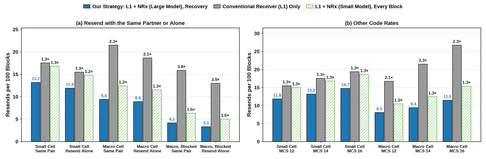</p>
<p align="center"><b>그림 2.</b> 재전송을 같은 짝과 / 혼자 보낼 때(a)와 MCS 12·14·16(b)의 100블록당 재전송</p>
<p align="center">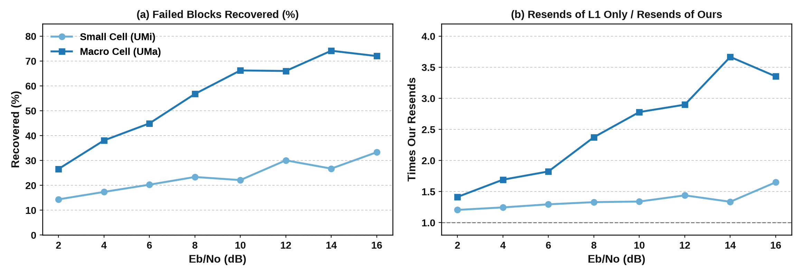</p>
<p align="center"><b>그림 3.</b> 신호 세기(Eb/No)별 복구한 실패 비율(a)과 재전송 배수(b)</p>

**그림 설명.** 그림 2(a)의 "Resend Alone"은 재전송 때 짝 사용자를 끈 조건으로, 재전송이 간섭 없이 들어온다. 그림 3은 2·4·14·16 dB(wide 실험)와 6–12 dB(기본 실험)를 이은 선이다; (b)의 1은 차이 없음이다.

**결과와 이유.**
- **재전송을 혼자 보내도 절감은 남는다** (소형 0.77배, 대형 0.48배, 가려진 대형 0.26배). 복구는 첫 수신만으로 끝내므로 재전송의 품질과 무관하다.
- **신호가 좋을수록 복구가 커진다** (대형 기지국 2 dB 27% → 14 dB 74%). 신호가 약하면 실패 원인이 잡음이라 어떤 수신기로도 못 풀고, 신호가 좋으면 원인이 사용자 간 간섭이라 강한 수신기가 푼다.

### 5.3 복구는 사용자 신호가 겹치는 쌍에서 일어난다

**요지.** 두 사용자 채널이 비슷한 쌍(상관 0.4 이상)이 소형 기지국 블록의 66%, 대형의 74%이고, 복구도 거기서 가장 많이 일어난다(소형 27–29%, 대형 44–68%).

<p align="center">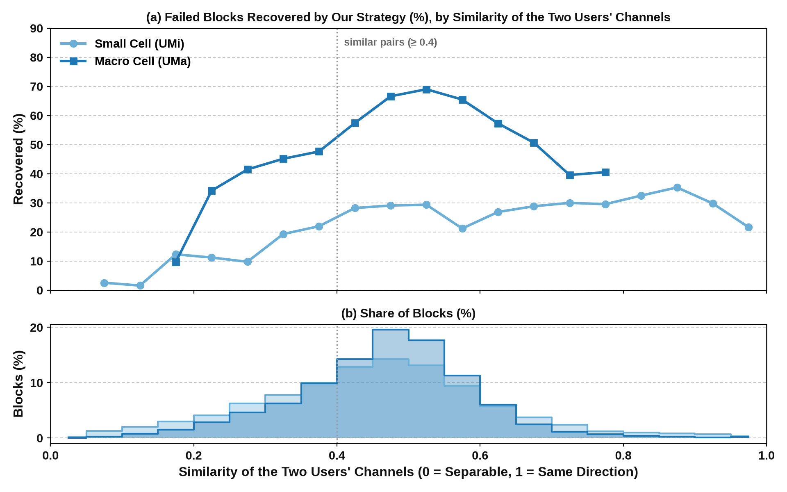</p>
<p align="center"><b>그림 4.</b> 두 사용자 채널의 상관 구간별 블록 비율(회색)과 복구한 실패 비율(파랑)</p>

**그림 설명.** 상관은 수신 안테나 방향에서 두 사용자 채널이 얼마나 같은 방향인지(0: 직교, 1: 같음)를 부반송파·심벌에 대해 평균한 값이다. 회색은 블록 비율, 파랑은 그 구간에서 기존 수신기가 실패한 블록 중 복구한 비율이다.

**결과와 이유.** 같은 상관 구간 안에서는 신호가 약한 사용자와 나머지의 복구 비율이 같다(13.7/14.0, 27.1/27.1, 27.7/29.9%). 복구가 되는지를 정하는 것은 사용자의 신호 세기가 아니라 두 사용자 신호의 겹침이다. 여러 사용자를 같은 자원에 묶는 상향 MU-MIMO에서 이런 쌍은 예외가 아니라 기본이다.

### 5.4 복구 경로에는 Large NRx가 필요하다

**요지.** 같은 실패 블록에서 Large NRx는 K-best의 1.1–1.3배, 작은 NRx의 1.4배, 반복 검출–복호의 2.2–2.6배, LDPC 50회의 5.5–6.1배를 살린다.

<p align="center">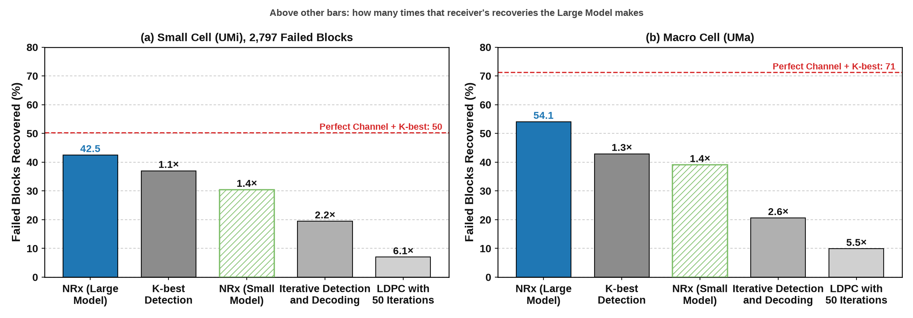</p>
<p align="center"><b>그림 5.</b> 같은 슬롯에서 기존 수신기 실패 블록을 수신기별로 살린 비율</p>

**그림 설명.** 같은 슬롯·같은 실패 블록에 수신기를 하나씩 적용했다(NVlabs 파이프라인, 기준은 LS 기존 수신기). 빨간 점선은 실제 채널을 아는 K-best로, 수신기로 얻을 수 있는 상한이다. 반복 검출–복호는 CRC를 통과한 code block을 다시 부호화해 빼는 SIC 방식이다.

**결과와 이유.** 고전 방법 셋을 모두 합쳐도 37.6%(소형)로 Large NRx 하나(42.5%)보다 적고, Large NRx가 못 살리는데 다른 방법이 살리는 블록은 0.6–0.9%뿐이다. LDPC를 더 돌리거나 복호된 사용자를 빼는 방법은 채널 추정과 검출의 오류를 고치지 못하고, Large NRx는 그것부터 다시 한다.

### 5.5 HARQ와 병렬로 두면 지연이 늘지 않고 꼬리가 줄어든다

**요지.** 정해진 시간 안에 못 받은 블록이 모든 시간에서 기존 수신기의 0.7배 이하다(소형 10 ms: 4.4 → 3.2%, 대형: 4.6 → 1.9%). 복구를 먼저 기다리는 방식만 지연이 늘어난다.

<p align="center">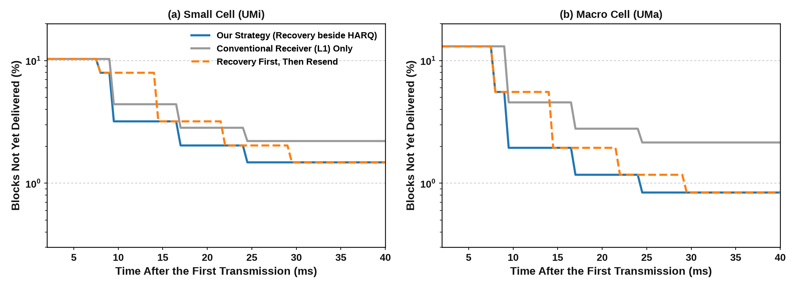</p>
<p align="center"><b>그림 6.</b> 첫 전송 뒤 시간별 아직 못 받은 블록의 비율(로그 축, DDDSU, grant 선행 4 ms)</p>

**그림 설명.** 선이 낮을수록 좋다. 파랑은 복구를 HARQ와 함께 돌리는 우리 방식, 회색은 기존 수신기만, 주황 점선은 복구 결과를 본 뒤에 재전송을 요청하는 방식이다. Large NRx 결과는 L1 1.4 ms + 6.3 ms 뒤에 나온다고 두었다(엔진만 재면 4.3 ms, 5.9절).

**결과와 이유.** 병렬로 두면 재전송은 그대로 요청하고 복구가 먼저 끝나면 블록이 그때 끝나므로 지는 시간이 없다. 복구를 먼저 기다리면 복구되지 않는 블록의 재전송이 상향 주기 하나(5 ms)만큼 늦어진다.

<p align="center">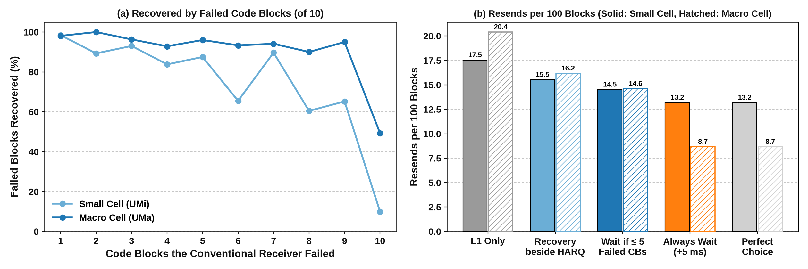</p>
<p align="center"><b>그림 7.</b> 기존 수신기가 실패한 code block 수별 복구 비율(a)과 방식별 100블록당 재전송(b)</p>

**그림 설명.** (a) TB 하나는 code block 10개로 나뉜다. 기존 수신기가 실패한 조각 수(L1이 끝나면 안다)별로 Large NRx가 살린 비율이다. (b) 실선 막대는 소형, 빗금은 대형 기지국이다. "Wait if ≤ 5"는 실패 조각이 5개 이하인 블록만 복구를 기다리고 나머지는 병렬로 돈다.

**결과와 이유.** 실패 조각이 1–5개면 84–100%가 살아나 기다려도 손해가 거의 없다. 그래서 지연은 HARQ만 쓸 때와 같으면서 재전송이 17.5 → 14.5(소형), 20.4 → 14.6(대형)으로 준다. 대형 기지국에서는 10조각이 모두 실패해도 49%가 살아나 조각 수만으로는 완벽한 선택(8.7)에 못 미친다 → 더 많은 정보를 쓰는 예측기를 계산 중이다(N10).

### 5.6 복구를 믿으면 더 빠른 전송 속도를 쓸 수 있다

**요지.** 외부 루프 링크 적응에 복구 결과를 넣으면 처리량이 소형 기지국에서 최대 1.21배, 대형에서 1.42배(목표 실패율 10%), 목표 3%에서는 대형 최대 1.75배, 가려진 대형 1.81배다.

<p align="center">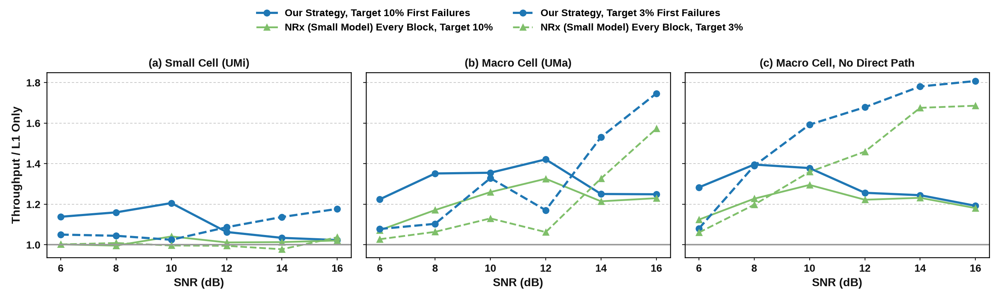</p>
<p align="center"><b>그림 8.</b> SNR별 처리량(기존 수신기만 = 1)</p>

**그림 설명.** MCS 10–16이 같은 채널 실현과 잡음을 공유하고, 외부 루프가 첫 전송 실패율 목표(실선 10%, 점선 3%)에 맞춰 MCS를 고른다. 복구된 블록은 성공으로 본다. 처리량은 전송 한 번당 전달한 비트다.

**결과와 이유.** 복구가 실패의 일부를 받아 주므로 외부 루프가 MCS를 1–1.5단계 올린다. 대형 기지국에서는 작은 NRx만으로도 처리량이 오르지만(1.07–1.33배), 우리 방식이 매 SNR에서 그보다 높다. 높은 SNR에서는 MCS 사다리 끝(16QAM, MCS 16)에 막혀 이득이 줄어든다.

### 5.7 복구는 좋은 짝을 찾는 수고를 대신한다

**요지.** 아무 짝이나 고른 뒤 복구를 더하면, 복구 없이 8명 중 가장 좋은 짝을 고른 것과 같거나 낫다(소형 재전송 12.2 대 12.8, 대형 9.1 대 16.4).

<p align="center">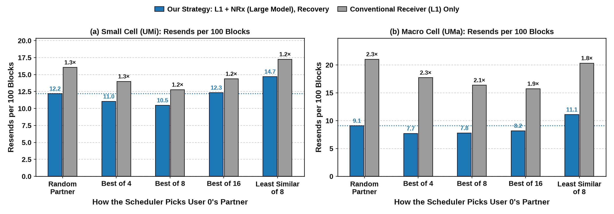</p>
<p align="center"><b>그림 9.</b> 스케줄러가 사용자 0의 짝을 고르는 방식별 100블록당 재전송</p>

**그림 설명.** 셀에 사용자 U명을 떨어뜨리고 사용자 0의 짝을 고른 뒤, 고른 두 사용자를 실제로 생성·복호했다. "Best of U"는 zero-forcing 뒤 약한 쪽 이득((1−ρ²)·min 이득)이 가장 큰 짝, "Least Similar"는 상관만 가장 낮은 짝이다. 파란 점선은 무작위 짝 + 복구의 높이다.

**결과와 이유.** 짝을 잘 고르면 기존 수신기의 재전송이 줄지만, 복구가 그보다 더 줄인다. 상관만 보고 고르면 무작위보다 나쁘다: 상관이 낮은 짝은 신호가 약한 경우가 많기 때문이다.

### 5.8 사용자와 안테나가 늘어도 수신기로 고칠 실패는 절반 이상이다

**요지.** 같은 자원의 사용자가 1 → 4명이면 기존 수신기 실패가 16 → 53%로 3.4배가 되고, 안테나가 8개여도 강한 수신기의 상한은 실패의 54–70%를 살린다.

<p align="center">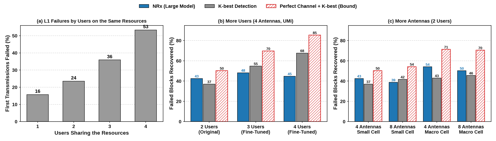</p>
<p align="center"><b>그림 10.</b> 사용자 수별 기존 수신기 실패(a), 사용자 수(b)·안테나 수(c)별 수신기가 살린 실패 비율</p>

**그림 설명.** (a)는 cuPHY 런타임, (b)(c)는 NVlabs 파이프라인이다. 빨간 빗금은 실제 채널을 아는 K-best 상한이다. 3–4명용과 8 안테나용 NRx는 우리가 NVlabs 2명·4 안테나 가중치에서 짧게 추가 학습한 모델이다.

**결과와 이유.** 사용자가 늘수록 복구할 실패가 급격히 늘어난다. 원 모델(2명·4 안테나)에서는 Large NRx가 K-best보다 낫고, 대형 기지국 8 안테나에서도 낫다(50 대 46%). 짧게 학습한 3–4명 모델과 소형 기지국 8 안테나 모델은 K-best보다 낮다(45–48 대 55–68%, 39 대 42%). 이 조건에서는 "복구 경로에 가장 강한 수신기를 쓴다"로 주장을 좁히고, 추가 학습을 진행 중이다.

### 5.9 GPU 비용

**요지.** Large NRx는 한 번에 A100 한 장을 다 쓰며 초당 233회를 처리한다. 모든 실패를 복구하면 A100 한 장이 기지국 2.4–2.5개를 감당한다.

<p align="center">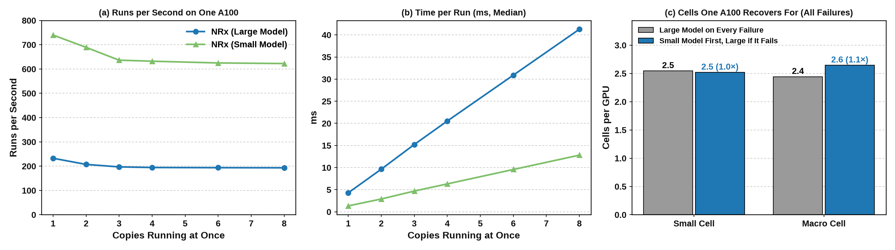</p>
<p align="center"><b>그림 11.</b> A100 한 장에서 NRx 동시 실행 수별 처리량(a)·1회 지연(b)과 GPU 한 장이 복구를 맡을 수 있는 기지국 수(c)</p>

**그림 설명.** (a)(b)는 TensorRT 엔진을 CUDA stream 여러 개에서 동시에 돌린 실측이다. (c)는 기지국 하나가 초당 요구하는 복구 수(상향 슬롯 400개/초 × 복구가 필요한 슬롯 비율 23–24%)로 처리량을 나눈 값이다. 오른쪽 막대는 작은 NRx를 먼저 쓰고 실패할 때만 Large NRx를 쓰는 연쇄다.

**결과와 이유.** 동시에 여러 개를 돌려도 처리량은 늘지 않고 지연만 늘어난다(1개 4.3 ms, 8개 41 ms). 연쇄는 Large NRx 실행을 30–39% 줄이지만 작은 NRx 실행 비용이 더해져 기지국 수는 1.0–1.1배에 그친다. 따라서 GPU를 아끼는 길은 살릴 블록을 고르는 것(5.5절, N10)이고, AI와 GPU를 나눠 쓰는 문제는 Antiphase(논문 B)가 다룬다.

### 5.10 살릴 블록을 미리 고르면 GPU의 절반으로 복구 가치의 83%를 얻는다

**요지.** L1이 끝난 시점의 정보만으로 Large NRx가 살릴 블록을 예측한다(15개 조건을 모은 AUC 0.865). 예측기가 고른 실패의 절반만 Large NRx에 주면 살릴 수 있는 블록의 83%를, 30%만 주면 62%를 얻는다.

<p align="center">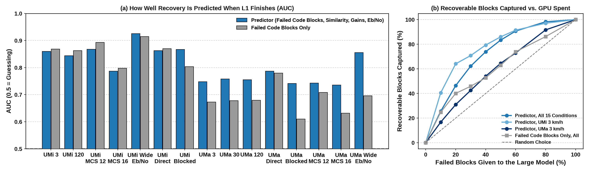</p>
<p align="center"><b>그림 12.</b> 조건별 복구 예측 정확도(a)와 Large NRx에 준 실패 비율 대비 얻은 복구(b)</p>

**그림 설명.** 예측기는 기존 수신기의 실패 조각 수, 짝 사용자의 실패 조각 수와 성공 여부, 짝 상관, 두 사용자의 채널 이득, Eb/No를 입력으로 하는 gradient-boosted tree다. 묶음 단위 5겹 교차 검증으로 학습과 평가 슬롯이 겹치지 않는다. (a)의 AUC는 0.5가 찍기, 1이 완벽이다. (b)는 예측 확률이 높은 순서로 실패 블록을 Large NRx에 줄 때, 준 비율(가로)과 살릴 수 있는 블록 중 얻은 비율(세로)이다. 점선은 무작위로 고를 때다.

**결과와 이유.**
- **소형 기지국에서는 실패 조각 수 하나로 충분하다**(AUC 0.79–0.93, 예측기와 비슷). 실패의 원인이 대부분 사용자 간 간섭이고, 조각이 일부만 실패한 블록이 거의 다 살아난다.
- **대형 기지국과 넓은 신호 범위에서는 예측기가 필요하다**(AUC 0.61–0.71 → 0.73–0.86). 조각이 모두 실패한 블록도 절반이 살아나므로, 짝 상관과 신호 세기가 있어야 가려낼 수 있다.
- **GPU 예산**: 모든 조건을 모으면 실패의 50%만 시도해 83%, 60%로 91%를 얻는다. 기지국 하나의 복구 수요를 절반으로 줄이면 A100 한 장이 맡을 기지국이 약 2배가 된다(5.9절). 실패 조각 수가 가장 중요한 입력이고(AUC 감소 0.26), 다음이 짝 상관(0.09)과 Eb/No(0.06)다.

### 5.11 기지국 사이 간섭: 공개 NRx의 빈자리와 간섭을 아는 복구 수신기 (진행 중)

**요지.** 공개 NVIDIA Large NRx는 단일 셀 3GPP UMi(열잡음만)로 학습됐다. 셀 안 사용자 1–2명의 간섭은 함께 검출하지만, 셀 간 간섭은 학습에도 평가에도 없다(NVlabs 논문 arXiv 2409.02912와 코드 확인; 기준선도 LMMSE·K-best이고 IRC 비교가 없다). 이웃 셀 사용자가 같은 자원을 쓰면, 간섭을 억제하는 고전 수신기(MMSE-IRC)가 크게 좋아지고 Large NRx 복구의 추가 이득은 작아진다. 그래서 간섭을 섞어 Large NRx를 다시 학습하는 "간섭을 아는 복구 수신기"를 만들고 있다.

**간섭 모델.** 실제 망은 모든 셀이 같은 주파수를 다시 쓰므로, 이웃 셀 사용자의 상향 신호가 우리 기지국에 들어온다(운영자 지표로 잡음 대비 간섭 3–10 dB). 생성기(`gen_harq.py --interferers 2 --inr-db X`)는 이웃 셀 사용자 2명을 같은 PRB에 둔다. 각자 시간에 따라 변하는 3GPP 채널을 갖고, 전송마다 새 데이터를 보내며, DMRS 스크램블이 우리와 다르다(자원 요소마다 무작위 위상). 세기는 잡음 대비 간섭(명목 3/6/10 dB; 채널 모델의 기지국 안테나 이득 때문에 실제값은 더 높으며, 기록한 채널 이득으로 계산해 함께 보고한다)이다. Eb/No 범위는 잡음+간섭의 상승분만큼 올려, 신호 대 간섭+잡음이 간섭 없는 실험(6–12 dB)과 같은 영역에 오게 했다. 기존 수신기는 cuPHY 기본값(잡음만 쓰는 MMSE)과 MMSE-IRC(cuPHY 알고리즘 2: DMRS에서 잡음+간섭 공분산을 추정해 결합) 둘 다 같은 신호로 받는다(`IRC=1`).

| 조건 (소형 기지국) | 첫 전송 실패 | 재전송/100 | 4회 뒤 실패 |
|---|---|---|---|
| 간섭 없음: MMSE / IRC / IRC + Large NRx 복구 | 10.4 / 11.4 / 11.4% | 17.4 / 19.3 / **13.1** | 2.13 / 2.33 / **1.43%** |
| 간섭 3 dB: MMSE / MMSE + 복구 | 13.9 / 13.9% | 23.1 / 17.9 | 2.65 / 2.02% |
| 간섭 3 dB: IRC / **IRC + 복구** | 8.8 / 8.8% | 14.4 / **13.6** | 1.68 / **1.55%** |

대형 기지국 간섭 없음: IRC 16.5 → IRC + 복구 9.2(0.56배).

**결과와 이유.**
- **간섭이 없을 때는 IRC를 기준선으로 써도 우위가 그대로다**(대형 기지국 0.56배).
- **간섭이 있으면 복구의 추가 이득이 작아진다**(IRC 대비 0.94배). IRC는 파일럿에서 간섭의 공간 구조를 추정해 억제하지만, 공개 NRx는 간섭을 본 적이 없다. 학습 단계에서도 같은 현상이 보인다: 원 모델의 손실이 간섭이 없으면 0.058, 간섭(0–10 dB)이 있으면 0.199로 3.4배다.
- **관련 연구와의 관계**: 간섭으로 학습한 신경 수신기가 IRC형 결합보다 낫다는 것(DeepRx, EqDeepRx), 배치 환경에 맞춘 미세 조정(NVlabs의 ray tracing 기반 조정, 온라인 재학습)은 이미 있다. 새로운 것은 공개 모델을 복구 경로에 그대로 쓸 때 셀 간 간섭이 그 값을 지운다는 측정과, AI-RAN 서버에서 셀의 간섭에 맞춰 복구 수신기를 다시 학습하는 배치 방식이다.
- **간섭을 아는 복구 수신기(N15)**: NVIDIA 학습 코드는 그대로 두고 채널에 이웃 셀 사용자 2명을 더해(잡음 대비 0–10 dB, 25%는 간섭 없음) 원 가중치에서 24만 반복 미세 조정한다(`src/train_nrx_ici.py`). TensorRT로 내보낸 뒤(원 모델을 같은 경로로 내보내 기존 엔진과 결과가 같은지 먼저 확인), 소형·대형 기지국 × 간섭 0/3/6/10 dB에서 IRC + 복구를 다시 잰다. 결과는 학습이 끝나는 대로 이 절에 넣는다.

## 6. 실험 목록

| ID | 실험 | 코드 | 상태 |
|---|---|---|---|
| N1·N2 | IR HARQ(RV 0·2·3·1, 최대 4회), UMi 3/30/60 km/h, 조건당 2만 블록 | `src/gen_harq.py`, `src/decode_harq.py`, `src/harq_stats.py`, `exp/harq_ir.sh` | 끝남. 재전송 0.75배, 복구 22–23%, 속도 무관(전대역이라 이득·짝 상관이 22 ms 안에 안 변함) |
| N1b | 재전송은 혼자 보냄 | `gen_harq.py --retx-alone` | 끝남. UMi 0.77배, UMa 0.48배, UMa 비가시선 0.26배 |
| N3 | UMi 120, UMa 3/30/120 km/h, UMa 가시선/비가시선 (UMa는 시드 2000으로 두 배) | `exp/harq_ir.sh` 옵션 | 끝남. UMa 복구 56–58%·0.42–0.44배, 비가시선 72–73%·0.26–0.27배, 가시선 27–28%·0.69–0.70배 |
| P1 | UMi 가시선/비가시선; 안테나 2/4/8 (UMi·UMa, 기존 수신기와 상한) | `exp/harq_ir.sh`, `exp/classical.sh --num-rx` | 끝남. 가시선 0.75배·비가시선 0.62배; 안테나가 늘어도 상한은 실패의 47–79%를 살림. 가시선/비가시선 시드 추가 진행 중 |
| P2 | 사용자 U명 중 짝 고르기(무작위, 이득·상관 기준, 상관만) × 복구 | `gen_harq.py --drop-users --pairing` | 끝남. 무작위 + 복구 ≈ 고른 짝 + 기존 수신기; 상관만 보고 고르면 무작위보다 나쁨(약한 사용자). 첫 계산(표 기반)은 무효 |
| N5 | 같은 슬롯에서 다른 복구 방법: LDPC 50회, IDD(SIC), LMMSE+K-best, 완전 CSI+K-best, Large/작은 NRx | `src/classical_rx.py`, `src/idd.py` | 끝남(UMi 실패 2,797, UMa 233). UMa 시드 추가 진행 중 |
| N6 | 외부 루프 링크 적응(MCS 10–16 같은 채널) | `exp/harq_mcs.sh`, `src/sim/olla.py` | 끝남(UMi, UMa, UMa 가시선/비가시선) |
| N7 | HARQ와 합치는 방식(기다림·병렬·선택)의 지연 | `src/sim/harq_latency.py` | 끝남. 병렬은 지는 지표 없음; 조각 수로 선택 |
| N8 | 셀당 사용자 1–4명: cuPHY 실패, 3–4명 복구(미세 조정 NRx 대 K-best) | `exp/users.sh`, `exp/classical.sh --users` | 끝남. 실패 16→24→36→53%; 3–4명에서는 K-best가 NRx보다 많이 살림 |
| N9 | GPU 수요 | `src/sim/demand.py` | 끝남. 슬롯의 23–24%가 복구 필요(동시 실행 가정은 N13으로 바로잡음) |
| MCS·wide | MCS 12/16, Eb/No 2·4·14·16 dB (UMi·UMa) | `MCS=…`, `--ebno` | 끝남. 같은 경향; 신호가 약하면 효과 작음, 좋으면 큼 |
| N4 | 1–4명 Large NRx 미세 조정(2명 가중치에서, 29만 반복) | `exp/n4_train.sh` | 끝남; 2명 성능은 떨어져 사용자 수별로 모델을 나눔. 53만 반복까지 추가 학습 중(queue_b) |
| N4b | 8 RX Large NRx: 4 RX 가중치를 넓혀 미세 조정(49만 반복) | `src/nrx_widen.py`, `exp/n4b_train.sh` | UMi에서 K-best보다 약간 낮고(38.8 대 41.7%) UMa에서 앞섬(50.2 대 45.5%); 학습률을 바꿔 21만 반복 추가 중(queue) |
| N10·N11 | L1 결과만으로 복구 성공 예측(조각 수, 짝의 성공, 상관, 이득), GPU 예산 대비 복구 가치 곡선 | `src/analysis/predictor.py` | 끝남. AUC 0.865(15조건), 실패의 50%만 시도해 복구 가치의 83% |
| N12 | 수신기 합집합과 연쇄(작은 NRx 먼저) | `src/analysis/union.py` | 끝남. 연쇄는 같은 양을 살리며 Large NRx 실행 30–39% 감소 |
| N13 | Large/작은 NRx의 A100 동시 실행 처리량·지연 | `src/nrx_lanes.py` | 끝남. Large 233회/초(4.3 ms), 작은 740회/초(1.3 ms); 동시 실행해도 처리량은 늘지 않음 |
| N15 | 기지국 사이 간섭(이웃 셀 사용자 2명, 잡음 대비 3/6/10 dB), MMSE-IRC 기준선, 간섭을 아는 Large NRx 학습 | `gen_harq.py --interferers --inr-db`, `decode_harq.py --irc`, `src/train_nrx_ici.py`, `exp/n15_*.sh` | 간섭 실험 node 1 진행 중, 학습·엔진·재실험 node 2 진행 중 |

## 7. 실행

- 큐 둘: `queue/`(노드 1)와 `queue_b/`(노드 2). 각 실행기가 interactive 노드를 스스로 잡고(사용자당 job 2개·job당 4노드·4시간), 다음 단계가 남은 시간에 안 들어가면 놓고 다시 잡는다. `queue/nodes`가 1보다 크면 첫 노드에서 단계를, 나머지 노드에서 부수 작업 묶음(`exp/side_pool.sh`)을 돌린다.
- `bash queue/watchdog.sh start`가 10분마다 두 실행기를 확인해 다시 띄운다(`queue/watchdog.log`). 멈추려면 그 큐에 `STOP` 파일. 단계는 `todo`, 끝난 단계는 `done`, 기록은 `runner.log`, 단계별 출력은 `logs/`.
- 한 조건: `bash exp/harq_ir.sh NAME CHUNKS --channel UMi --speed 0.83 --ebno 6,8,10,12 --slots 64` (GPU 네 장에서 묶음 병렬; `SEED0`로 시드, `MCS`로 MCS).
- 결과 표 다시 만들기: `python3 src/analysis/summarize.py` (nersc-python 3.13), 구간: `src/ci.py`.

## 8. 디렉터리

```
env.sh            컨테이너 경로와 실행 함수(rx: cuPHY·pyAerial·TensorRT, tfgen: TensorFlow·Sionna)
src/              실험 코드; src/vendor는 airan_cloudlab에서 복사한 수신기 코드(SOURCE.md); src/sim 시뮬레이션; src/analysis 분석
exp/              실험 구동 스크립트
queue/, queue_b/  이 프로젝트 전용 큐 실행기
figures/          평가 그림(make_figures.py → figures/eval/*.png)
docs/             계획(PLAN.md), 관련 연구(related_work.md), 결과와 분석(RESULTS.md)
results/          결과(json, txt; 묶음별 npz는 git에서 제외), results/summary 모든 결과의 표
data/             생성한 수신 신호(git에서 제외, 묶음이 끝나면 지움)
third_party/      NVlabs neural_rx 사본(설정 파일을 쓰므로 복사; git에서 제외)
```
